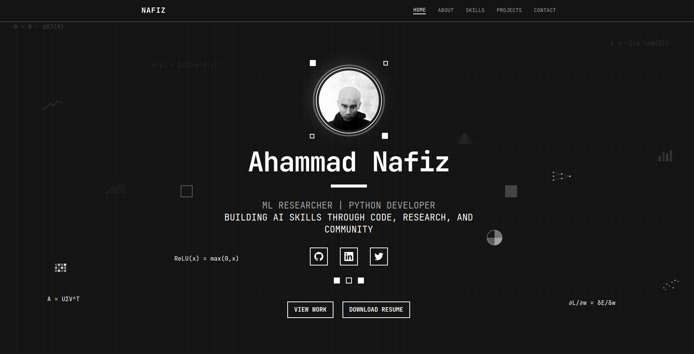

<div align="center">
  
# 🎯 Minimal Portfolio - Ahammad Nafiz

</div>

<div align="center">



**A modern, pixel-art inspired portfolio showcasing ML research and development work**

[](https://nextjs.org/)
[](https://www.typescriptlang.org/)
[](https://tailwindcss.com/)
[](https://reactjs.org/)

[🌐 Live Demo](https://ahammadnafiz.github.io/portfolio) • [📧 Contact](mailto:ahammadnafiz86@gmail.com) • [💼 LinkedIn](https://linkedin.com/in/ahammad-nafiz)

</div>

## ✨ Features

### 🎨 Design & Aesthetics
- **Pixel-art monochrome theme** with retro computing aesthetics
- **Responsive design** optimized for all screen sizes
- **Smooth animations** and interactive elements
- **Modern UI components** built with Radix UI and shadcn/ui

### 🧠 Interactive ML Visualizations
- **Live CNN filter visualization** showing convolution operations
- **Neural network propagation animations** in project cards
- **ML-themed background elements** with mathematical equations
- **Real-time processing indicators** and progress tracking

### 🚀 Technical Features
- **Server-side rendering** with Next.js 15
- **Type-safe development** with TypeScript
- **Optimized performance** with modern web standards
- **PWA capabilities** with service worker registration
- **SEO optimized** with proper metadata

## 🛠️ Tech Stack

<div align="center">

| Category | Technologies |
|----------|-------------|
| **Frontend** |    |
| **Styling** |   |
| **UI Components** |   |
| **Form Handling** |   |
| **Build Tools** |   |

</div>

## 📂 Project Structure

```
minimal-portfolio/
├── 📱 app/                 # Next.js app directory
│   ├── globals.css         # Global styles & CSS variables
│   ├── layout.tsx          # Root layout component
│   └── page.tsx            # Home page
├── 🧩 components/          # React components
│   ├── about.tsx           # About section with CNN visualization
│   ├── contact.tsx         # Contact information
│   ├── hero.tsx            # Hero section with ML animations
│   ├── navigation.tsx      # Navigation bar
│   ├── projects.tsx        # Projects showcase
│   ├── skills.tsx          # Technical skills grid
│   └── ui/                 # Reusable UI components (shadcn/ui)
├── 🎣 hooks/               # Custom React hooks
├── 🔧 lib/                 # Utility functions
├── 🎨 styles/              # Additional styling
├── 🌍 public/              # Static assets
│   ├── favicon.ico         # Site favicon
│   ├── *.png               # Icons and images
│   └── Nafiz CV Updated.pdf # Resume download
└── ⚙️  config files        # Next.js, Tailwind, TypeScript configs
```

## 🚀 Quick Start

### Prerequisites
- **Node.js** 18+ 
- **pnpm** (recommended) or npm

### Installation

1. **Clone the repository**
   ```bash
   git clone https://github.com/ahammadnafiz/minimal-portfolio.git
   cd minimal-portfolio
   ```

2. **Install dependencies**
   ```bash
    npm install --legacy-peer-deps
   ```

3. **Start development server**
   ```bash
   npm run dev
   ```

4. **Open in browser**
   ```
   http://localhost:3000
   ```

### Build & Deploy

```bash
# Build for production
pnpm build

# Start production server
pnpm start

# Export static files
pnpm export
```

## 🔄 Cache Busting System

This portfolio includes a sophisticated cache busting system to ensure users always get the latest version of your site. **Everything is now integrated into a single deployment script!**

### 🚀 One-Command Deployment

```bash
# Complete deployment with automatic cache busting
./deploy-optimized.sh
```

This single script handles:
- ✅ Clean build environment setup
- ✅ Cache busting component verification  
- ✅ Unique build ID generation
- ✅ Environment variable updates
- ✅ Next.js build with cache busting
- ✅ Service worker configuration
- ✅ Deployment preparation
- ✅ Comprehensive verification

### 📖 Complete Guide

For detailed information, see: **[CACHE_BUSTING_GUIDE.md](./CACHE_BUSTING_GUIDE.md)**

### Quick Reference

```bash
# Update cache busting variables (Shell script)
npm run update-cache

# Update cache busting variables (Node.js script)
npm run update-cache:node

# Deploy with automatic cache busting
npm run deploy
```

### Manual Cache Busting

#### Using Shell Script (Linux/macOS)
```bash
./update-cache-bust.sh
```

#### Using Node.js Script (Cross-platform)
```bash
node update-cache-bust.js
```

#### Using npm Scripts
```bash
# Shell version
npm run update-cache

# Node.js version  
npm run update-cache:node
```

### Environment Variables

The cache busting system uses two environment variables in `.env.local`:

```bash
# Unique build identifier
NEXT_PUBLIC_BUILD_ID=ca36b0f-1748594503131

# Build timestamp
NEXT_PUBLIC_BUILD_TIME=2025-05-30T08:41:43.131Z
```

### Components Involved

- **`components/cache-buster.tsx`**: React component that detects version changes
- **`public/cache-buster.js`**: Standalone script for cache clearing
- **`public/sw.js`**: Service worker with cache management
- **`update-cache-bust.sh`**: Shell script to update variables
- **`update-cache-bust.js`**: Node.js script to update variables

### Development Workflow

1. **Make changes** to your portfolio
2. **Update cache variables** using one of the update scripts
3. **Restart development server** to pick up new environment variables
4. **Test locally** to ensure cache busting works
5. **Deploy** using the deploy script for automatic cache busting

### Deployment

The `deploy-optimized.sh` script automatically:
- Generates fresh build IDs
- Updates `.env.local` 
- Builds the project with new variables
- Prepares optimized static files for GitHub Pages

```bash
./deploy-optimized.sh
```

### Troubleshooting

If cache busting isn't working:

1. **Check environment variables**: Ensure `.env.local` exists and has valid values
2. **Restart dev server**: Changes to `.env.local` require a restart
3. **Clear browser cache**: Manually clear browser cache and storage
4. **Check service worker**: Open DevTools → Application → Service Workers
5. **Verify build ID**: Check console for build ID logs

## 🎯 Key Sections

### 🏠 Hero Section
- **Animated profile introduction** with pixel-art styling
- **ML-themed background elements** (equations, charts)
- **Social media links** with hover effects
- **Download resume** functionality

### 👨‍💻 About Section
- **Interactive CNN visualization** showing real-time convolution operations
- **Personal story** and career journey
- **Responsive grid animation** adapting to screen size
- **Technical expertise** highlights

### 🛠️ Skills Section
- **Technology stack showcase** with icon integration
- **Categorized skills** (Programming, AI/ML, Tools)
- **Hover animations** and transitions
- **DevIcon integration** for technology logos

### 💼 Projects Section
- **Featured project cards** with detailed descriptions
- **Animated backgrounds** representing different ML concepts
- **Technology tags** and live links
- **GitHub integration** for source code access

### 📬 Contact Section
- **Multiple contact methods** (email, phone, social)
- **Professional links** (GitHub, LinkedIn, Blog)
- **Responsive layout** with call-to-action buttons

## 🎨 Customization

### Color Scheme
The portfolio uses CSS custom properties for theming:

```css
/* Light theme variables */
--background: 0 0% 100%;
--foreground: 0 0% 3.9%;
--accent: 0 0% 9%;
--accent-foreground: 0 0% 98%;
```

### Animation Speed
Adjust animation timings in component files:

```tsx
// Example: CNN animation speed
const interval = setInterval(() => {
  setAnimationStep(prev => prev + 1)
}, 300) // Modify this value
```

## 📊 Performance Features

- ⚡ **Optimized images** with Next.js Image component
- 🗜️ **Code splitting** and lazy loading
- 📱 **Progressive Web App** capabilities
- 🔄 **Service Worker** for caching
- 🎯 **SEO optimization** with meta tags

## 🤝 Contributing

Contributions are welcome! Please feel free to submit a Pull Request.

1. Fork the project
2. Create your feature branch (`git checkout -b feature/AmazingFeature`)
3. Commit your changes (`git commit -m 'Add some AmazingFeature'`)
4. Push to the branch (`git push origin feature/AmazingFeature`)
5. Open a Pull Request

## 📄 License

This project is open source and available under the [MIT License](LICENSE).

## 👨‍💻 About the Developer

**Ahammad Nafiz** - ML Researcher & Python Developer

- 🔬 **Focus Areas**: Natural Language Processing, Reinforcement Learning, Transformer Architectures
- 🎓 **Role**: Head of R&D at UIU Data Science Club
- 🛠️ **Projects**: FizTorch (Deep Learning Framework), Predicta (AutoML Pipeline)
- 🌐 **Website**: [ahammadnafiz.github.io](https://ahammadnafiz.github.io)

---

<div align="center">

**Built with ❤️ using Next.js, TypeScript, and Tailwind CSS**

[⭐ Star this repo](https://github.com/ahammadnafiz/minimal-portfolio) if you found it helpful!

</div>